# InterMet · Cursos y congresos digitales de minería

Plataforma web para vender los cursos y congresos digitales de InterMet y los **Programas de Alta Especialización Minera (PAEM)**.
El cliente elige, paga con su **link de pago (Niubiz)**, registra su pago con la constancia y recibe los enlaces de descarga en su correo.

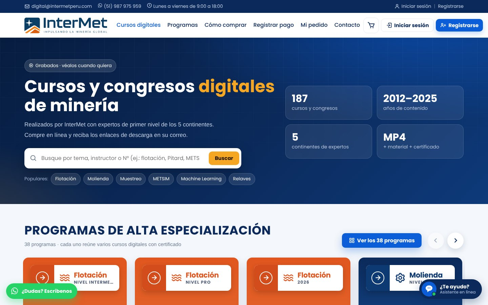

## Funciones principales

- **Catálogo** de cursos y congresos digitales con buscador, filtro por año e idioma, y página propia de cada curso.
- **38 programas de alta especialización (PAEM)**, cada uno con su página: galería, temario por módulos, precio con el ahorro y los cursos que incluye.
- **Carrito**: el cliente puede llevar varios programas y pagar cada uno con su link.
- **Ventana de bienvenida** que presenta los programas al entrar a la web.
- **Asistente (chat)** que responde solo sobre los cursos y congresos digitales de minería.
- **Panel de administración**: pedidos, verificación de pagos, cursos, programas (temario, portada, miniaturas, link de pago), filtros con o sin link de pago, usuarios y configuración.
- Diseño adaptado a **celular**.

## Capturas

### Ventana de bienvenida
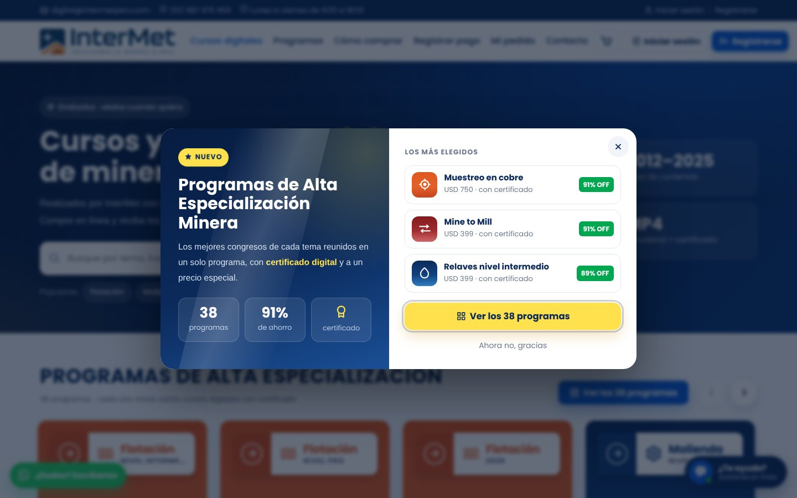

### Programas en la portada
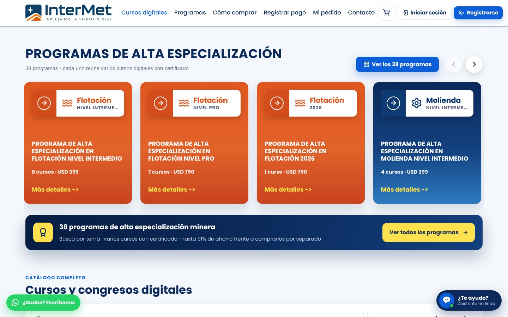

### Catálogo de cursos y congresos
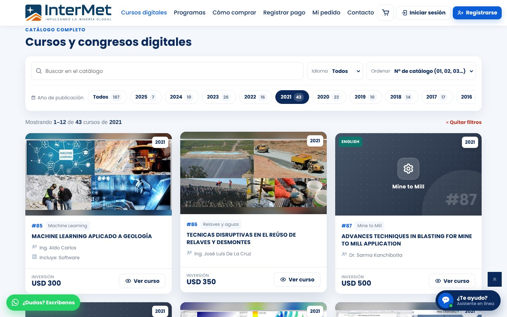

### Página de los programas de alta especialización
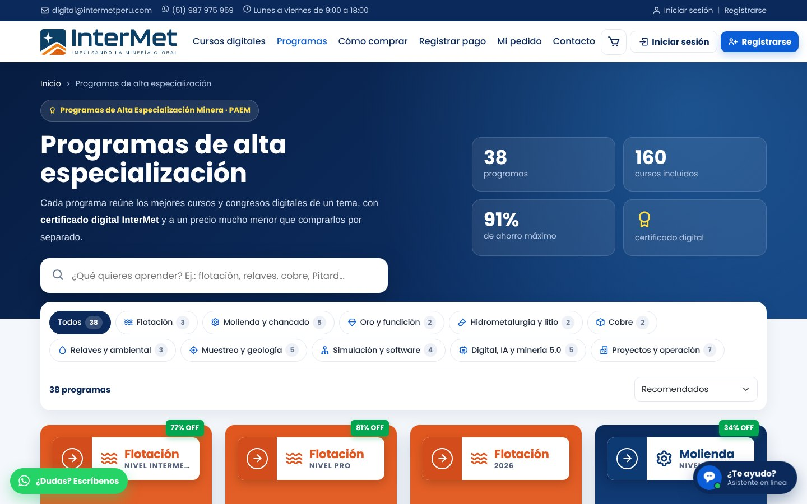

### Página de un programa
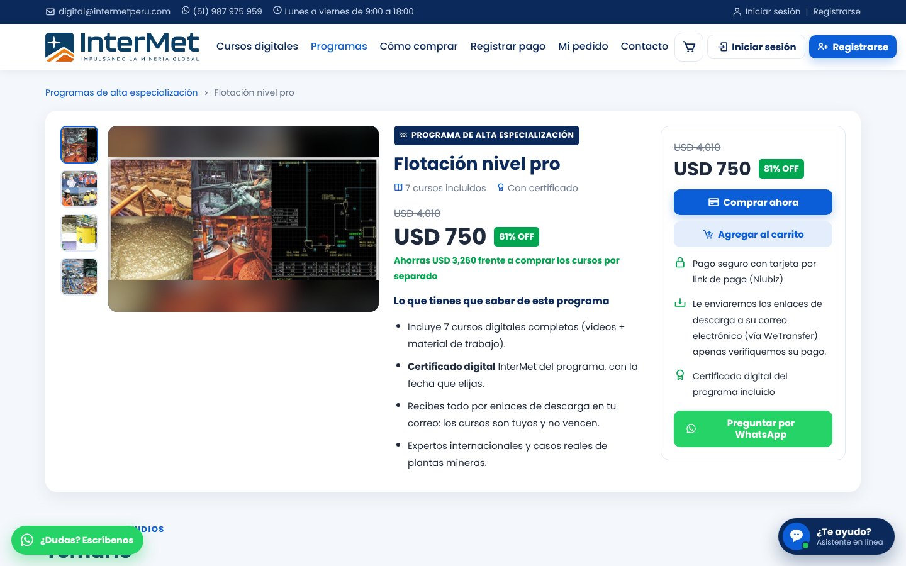

### Carrito
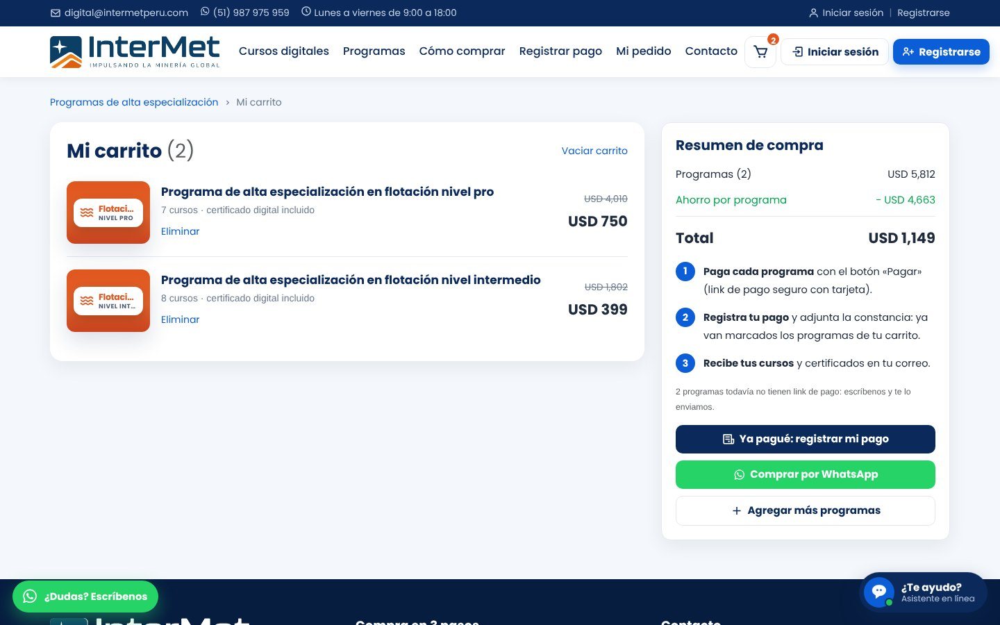

### Asistente
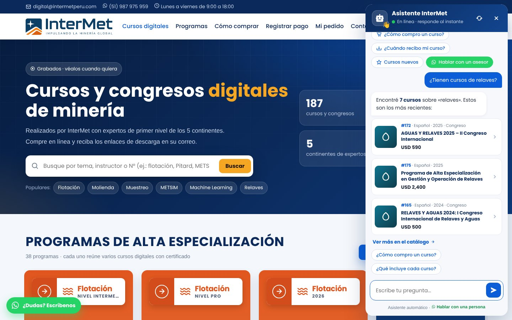

### En el celular
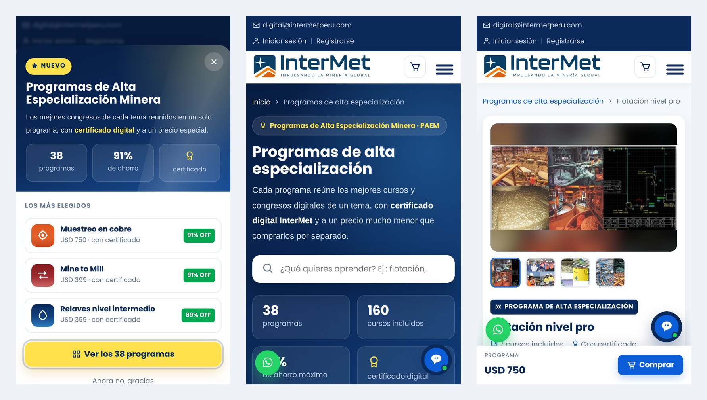

### Panel · Programas
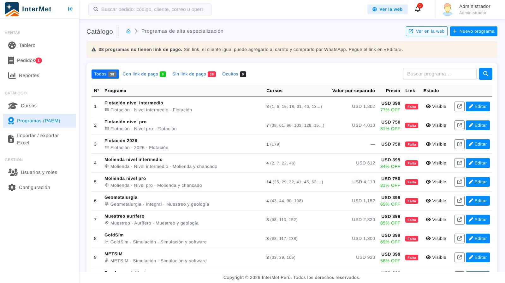

### Panel · Editar programa
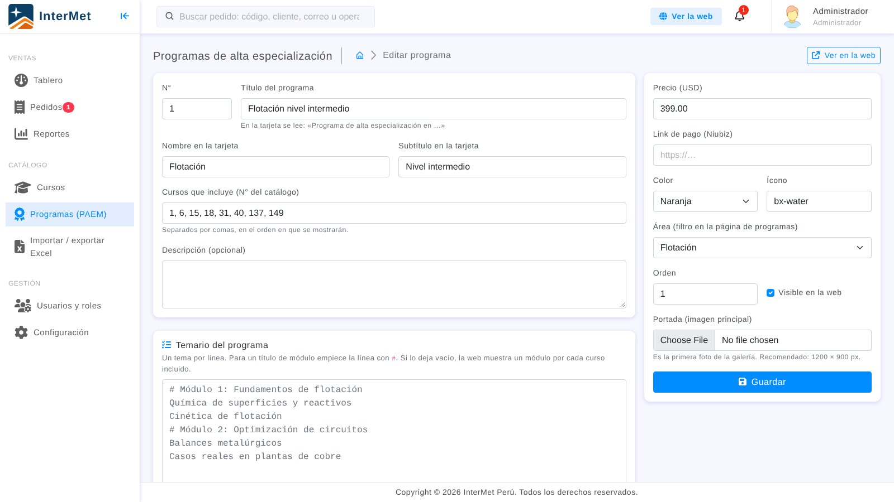

## Tecnología

Laravel 13 (PHP) · MySQL / MariaDB · Blade · Vite · Bootstrap 5

## Instalación

```
composer install
npm install
npm run build
cp .env.example .env
php artisan key:generate
php artisan migrate --seed
php artisan serve
```

La guía completa (Laragon, compartir en red o por internet, importar imágenes, panel) está en **[INSTRUCCIONES.md](INSTRUCCIONES.md)**.

---
© InterMet Perú. Todos los derechos reservados.
